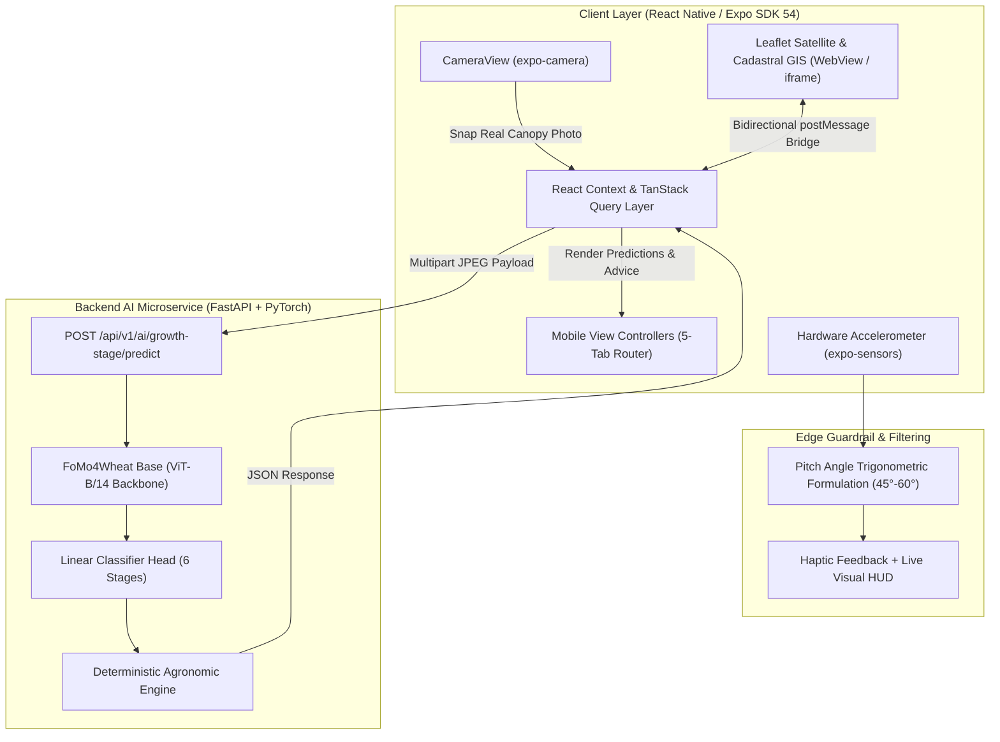
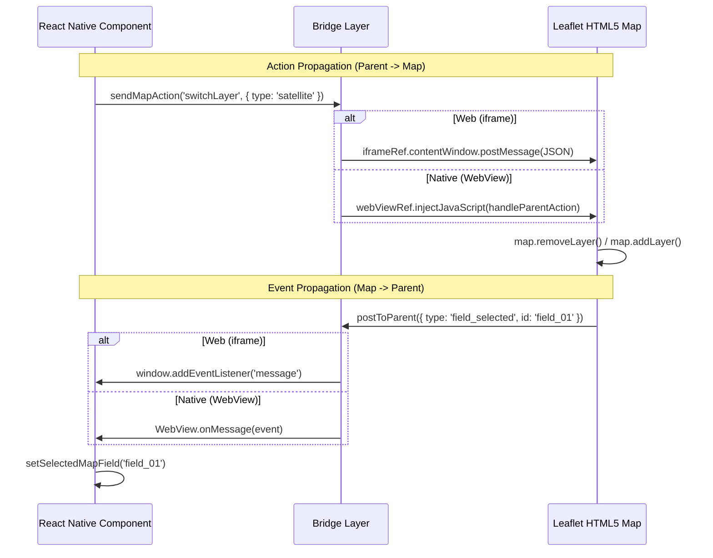

# NextGenYield: Technical Implementation & Architecture Report

> **Document Purpose**: This comprehensive technical document details the engineering specifications, mathematical formulations, sensor fusion algorithms, Vision Transformer (ViT-B/14) inference pipelines, interactive GIS Leaflet bridge, and UI/UX responsiveness architecture implemented in **NextGenYield**. It serves as an authoritative reference for project maintenance and can be directly incorporated into thesis, final year project (FYP) reports, and research publications.

---

## Table of Contents
1. [System Overview & Architecture](#1-system-overview--architecture)
2. [Edge Angle Sensor Fusion Engine ($45^\circ - 60^\circ$ Compliance)](#2-edge-angle-sensor-fusion-engine)
3. [Real Hardware Camera Integration (`expo-camera`)](#3-real-hardware-camera-integration)
4. [Foundation Model (FoMo4Wheat ViT-B/14) Inference Pipeline](#4-foundation-model-fomo4wheat-vit-b14-inference-pipeline)
5. [Interactive Cadastral & Satellite Leaflet GIS Engine](#5-interactive-cadastral--satellite-leaflet-gis-engine)
6. [Elimination of Hardcoded Fallbacks & Error Transparency](#6-elimination-of-hardcoded-fallbacks--error-transparency)
7. [Screen Responsiveness & Consolidated Navigation](#7-screen-responsiveness--consolidated-navigation)
8. [Data Models & Schema Specifications](#8-data-models--schema-specifications)
9. [Bilingual Localization & Farmer Accessibility Architecture](#9-bilingual-localization--farmer-accessibility-architecture)

---

## 1. System Overview & Architecture

NextGenYield is a mobile-first, edge-assisted agricultural decision support system designed specifically for wheat farmers and agricultural stakeholders. The architecture decouples client-side physical hardware sensing from high-throughput deep learning inference hosted on dedicated GPU microservices.



---

## 2. Edge Angle Sensor Fusion Engine

### 2.1 Agronomic Rationale for $45^\circ - 60^\circ$ Downward Angle
In wheat canopy photography, image capture angle strongly influences feature visibility:
- **Nadir / Flat Angle ($> 75^\circ$)**: Fails to capture vertical stem node elongation during jointing and obscures spike emergence inside the swollen flag leaf sheath during booting.
- **Horizontal / Distant Angle ($< 40^\circ$)**: Introduces background noise, horizon interference, uneven field shadows, and perspective foreshortening.
- **Oblique Sweet Spot ($45^\circ - 60^\circ$)**: Optimally balances vertical canopy depth with horizontal tiller and leaf density, maximizing feature capture for the ViT-B/14 patch projection layers.

### 2.2 Mathematical Formulation
The device measures normalized gravitational acceleration vectors along three orthogonal spatial axes using the physical accelerometer:
$$\vec{a} = [a_x, a_y, a_z]^T$$

When a farmer holds the smartphone in portrait orientation tilted forward to face the crop canopy:
1. $a_x$ captures lateral roll tilt.
2. $a_y$ captures vertical axis acceleration ($a_y \to -1g$ in upright vertical posture).
3. $a_z$ measures the normal vector perpendicular to the phone screen ($a_z \to 1g$ when screen faces straight up toward the sky).

The downward pitch angle $\theta$ (measured in degrees relative to the horizontal plane) is formulated as:

$$\theta = \text{round}\left( \text{atan2}\left(|a_z|, \sqrt{a_x^2 + a_y^2}\right) \times \frac{180}{\pi} \right)$$

Where:
- $\sqrt{a_x^2 + a_y^2}$ provides roll-invariant compensation when the farmer slightly tilts the phone sideways.
- The angle is clamped to the physically meaningful domain:
$$\theta_{\text{clamped}} = \max(0, \min(90, \theta))$$

### 2.3 State Compliance Logic
```typescript
const isAngleGood = downwardAngle >= 45 && downwardAngle <= 60;

// Directional advice logic:
if (isAngleGood) {
  // Optimal angle: emit green bracket borders & trigger light haptic pulse
  hudText = t.angleGoodBadge; // "Good to Go (45°–60°)"
} else if (downwardAngle < 45) {
  // Camera pointing too forward/upward
  hudText = `${downwardAngle}° · ${t.tiltCameraDown}`; // "Tilt phone down towards canopy (45°–60°)"
} else {
  // Camera pointing too directly downward
  hudText = `${downwardAngle}° · ${t.tiltCameraUp}`;   // "Tilt phone up slightly (target: 45°–60°)"
}
```

---

## 3. Real Hardware Camera Integration (`expo-camera`)

### 3.1 Migration from Mock Asset to `CameraView`
Previous prototypes relied on a static bundled asset (`wheat_scan_sample.jpg`). The production implementation integrates `CameraView` from Expo SDK 54 (`expo-camera: ~17.0.10`), directly interfacing with iOS AVFoundation and Android Camera2 native APIs.

### 3.2 Key Features
- **Dynamic Permission Resolution**: Evaluates `useCameraPermissions()`. If denied, renders an accessible onboarding card offering permission retry or instant local gallery file selection.
- **Hardware Controls**:
  - Front / Back sensor toggling (`facing: 'back' | 'front'`).
  - Torch / Flash illumination mode (`flash: 'off' | 'on'`).
- **Capture Quality**: `takePictureAsync({ quality: 0.85 })` balances ViT patch resolution requirements ($518 \times 518$ input) with minimal payload transmission latency ($< 350\text{ KB}$ per compressed JPEG).
- **Web Graceful Fallback**: On desktop browsers or emulator environments without webcam access, renders an accessible file upload dropzone.

---

## 4. Foundation Model (FoMo4Wheat ViT-B/14) Inference Pipeline

### 4.1 Backend Architecture
The model backbone is **FoMo4Wheat_base (ViT-B/14)** with 86.6 million parameters, pre-trained on agricultural canopy datasets.

```
[Raw Canopy Photo: 0.85 JPEG] 
       │
       ▼
[Image Preprocessing: Resize & Bicubic Interpolation to 518 × 518]
       │
       ▼
[ViT-B/14 Patch Extraction: 14 × 14 patches -> 1369 tokens + 1 [CLS] token]
       │
       ▼
[12 Multi-Head Self-Attention Transformer Encoder Layers (Hidden dim: 768)]
       │
       ▼
[Linear Classifier Head: Logits for 6 Phenological Stages]
       │
       ▼
[Softmax Function: Probability Distribution p ∈ [0, 1]^6]
```

### 4.2 Biological Stages & Categorization
The six classified biological stages are:
1. **Tillering ($k=0$)**: Secondary shoot emergence from root crown.
2. **Jointing ($k=1$)**: Vertical stem elongation with palpable nodes.
3. **Booting ($k=2$)**: Inflorescence swelling inside flag leaf sheath.
4. **Flowering / Anthesis ($k=3$)**: Pollen shed from delicate anthers.
5. **Grain Filling ($k=4$)**: Milk to soft dough kernel accumulation.
6. **Maturity ($k=5$)**: Golden dry canopy ready for mechanical harvest.

### 4.3 API Request & Response Contract
- **Endpoint**: `POST /api/v1/ai/growth-stage/predict`
- **Content-Type**: `multipart/form-data`
- **Fields**:
  - `image`: Binary JPEG file.
  - `field_id`: Alphanumeric field code (`PK-FSD-01`).
  - `crop_type`: `"wheat"`.

**Response Payload**:
```json
{
  "status": "success",
  "data": {
    "stage_index": 2,
    "stage_name": "booting",
    "raw_class": "2_booting",
    "confidence": 0.9421,
    "confidence_rating": "high",
    "crop_type": "wheat",
    "probabilities": {
      "tillering": 0.0012,
      "jointing": 0.0451,
      "booting": 0.9421,
      "anthesis": 0.0104,
      "grain_filling": 0.0011,
      "maturity": 0.0001
    },
    "model_metadata": {
      "backbone": "FoMo4Wheat_base (ViT-B/14)",
      "classifier_head": "nextgenyield_wgsp_head_v1",
      "version": "fomo4wheat-wgsp-v1",
      "device": "cuda:0",
      "inference_latency_ms": 19.75
    },
    "advisory": {
      "display_name": "Booting",
      "primary_objective": "Pollen development and wheat spike protection inside the flag leaf sheath.",
      "summary": "Crop is in the Booting stage. The head is actively swelling inside the sheath of the flag leaf.",
      "irrigation_guidance": "Critical moisture window. Water deficit during booting irreversibly reduces potential spikelet count and head length.",
      "nutrient_guidance": "Avoid heavy granular nitrogen. Apply corrective foliar micronutrients (Zinc, Boron) if micronutrient deficiency symptoms are visible.",
      "protection_guidance": "Protect the flag leaf at all costs (it drives > 50% of eventual grain yield). Spray protective fungicide if stripe rust or powdery mildew is present in the field.",
      "risk_alerts": [
        "Flag leaf damage directly slashes ultimate harvest yield by up to 50%.",
        "Moisture stress right before heading causes sterile florets."
      ]
    }
  }
}
```

---

## 5. Interactive Cadastral & Satellite Leaflet GIS Engine

### 5.1 Free, Zero-API-Key GIS Imagery
NextGenYield uses dual high-resolution tile layers requiring zero proprietary API keys:
1. **Esri World Imagery (Satellite Layer)**:
   `https://server.arcgisonline.com/ArcGIS/rest/services/World_Imagery/MapServer/tile/{z}/{y}/{x}`
   Provides sub-meter true-color satellite imagery of Punjab agricultural districts.
2. **CartoDB Voyager (Cadastral & Street Layer)**:
   `https://{s}.basemaps.cartocdn.com/rastertiles/voyager/{z}/{x}/{y}{r}.png`
   Provides crisp vector roads, canal waterways, and village boundary lines.

### 5.2 Bidirectional Bridge for Web & Native
To achieve 100% feature parity across native iOS/Android (via `react-native-webview`) and Web browsers (via `<iframe>`), a unified messaging protocol is implemented:



### 5.3 Geodesic Area Calculation (Shoelace Formula)
Field boundaries are delineated by dropping geographic coordinates $[(\phi_1, \lambda_1), (\phi_2, \lambda_2), \dots, (\phi_n, \lambda_n)]$. 

Acreage is calculated in real time using the spherical polygon Shoelace formulation over Earth radius $R = 6,378,137\text{ m}$:

$$A_{\text{sqm}} = \frac{R^2}{2} \left| \sum_{i=1}^{n} (\lambda_{i+1} - \lambda_i) \cdot (2 + \sin\phi_i + \sin\phi_{i+1}) \right|$$

$$\text{Acres} = \frac{A_{\text{sqm}}}{4046.8564224}$$

Hardcoded dummy fallback coordinates have been completely eliminated: saving a field requires at least 3 genuine corner vertices on the map canvas.

---

## 6. Elimination of Hardcoded Fallbacks & Error Transparency

### 6.1 Strict Policy of Reality
Prior versions contained mock simulation fallbacks (`MOCK_BOOTING_PREDICTION` and `setTimeout` fake shutter clicks). This has been removed in favor of strict empirical accuracy:
1. **No Fake Captures**: Shutter release invokes the genuine hardware camera.
2. **No Mock Booting Fallbacks**: When backend inference is requested, an actual HTTP `POST` request is dispatched to the configured FastAPI server.
3. **Transparent Error Diagnostics**: If the server is offline or the pinggy/cloudflare tunnel has expired:
   - The UI displays an explicit error banner showing the target URL and HTTP failure details.
   - Provides an in-app **Server Settings Modal** to update the base URL dynamically without editing code or rebuilding binaries.
   - Displays real-time server health polling status (`Online` vs `Offline`) and latency in milliseconds.

---

## 7. Screen Responsiveness & Consolidated Navigation

### 7.1 Consolidated 5-Tab Layout
The redundant temporary tab (`ai-stage.tsx`) has been removed from the navigation manifest. The application presents five clean, balanced tabs:
1. **Home (`index`)**: Field overview, Days After Sowing (DAS), weather, next agronomic action card, and link to AI camera.
2. **Scan (`scan`)**: Unified real-time camera viewfinder, downward angle HUD ($45^\circ-60^\circ$), live ViT-B/14 inference, and agronomic advisory sheet.
3. **Map (`map`)**: Interactive satellite/cadastral GIS map, parcel selection, and boundary drawing tools.
4. **Yields (`showcase`)**: Peer benchmark showcase and proven 140-day wheat management schedules.
5. **Profile (`profile`)**: Farmer details, total acreage, season yield ledger, and regional credentials.

### 7.2 Mobile & Web Responsiveness
- **Adaptive Safe Area Handling**: Uses `useSafeAreaInsets` to adjust top headers and bottom control bars dynamically for device notches, camera punch-holes, and system home bars.
- **Fluid Geometry**: Flexible flexbox hierarchies prevent element clipping on compact screens (e.g., iPhone SE or entry-level Android devices).
- **Dynamic Font Scaling**: All typography scales proportionally with user-selected accessibility settings (`fontMultiplier`).

---

## 8. Data Models & Schema Specifications

### 8.1 Field Observation Schema
```typescript
export interface FieldObservation {
  id: string;               // Unique observation identifier ('obs_1712345678')
  date: string;             // Human readable formatted date ('Just now')
  daysAgo: string;          // Elapsed interval representation ('Today')
  stageIndex: number;       // Biological index (0 to 5)
  stageName: string;        // Stage descriptor ('Booting' / 'گوبھ')
  confidence: number;       // Classification probability (e.g., 0.9421)
  imageUri: string;         // Local or remote URI of canopy photograph
  sharpnessScore: number;   // Laplacian variance sharpness metric (0-100)
  angleScore: number;       // Recorded hardware downward angle in degrees (45°-60°)
}
```

### 8.2 Regional Map Field Schema
```typescript
export interface MapFieldItem {
  id: string;
  code: string;             // Alphanumeric parcel code ('PK-FSD-01')
  name: string;             // Display name ('Canal Block East')
  stageIndex: number;
  stageName: string;
  variety: string;          // Wheat cultivar ('Akbar-2019')
  yieldKgSqm: number;
  color: string;            // Stage indicator hex color
  acres: number;            // Surface area in acres
  isMine: boolean;          // Ownership flag
  shapeType?: 'polygon' | 'rectangle' | 'square' | 'circle';
  cycleStatus?: 'not_started' | 'active' | 'completed';
  coordinates?: [number, number][]; // Geodesic boundary coordinates [lat, lng]
}
```

---

## 9. Bilingual Localization & Farmer Accessibility Architecture

### 9.1 Localization Tables
All text is mediated through centralized translation tables (`constants/translations.ts`), supporting instant English (`en`) and Urdu (`ur`) rendering:

| Key | English (`en`) | Urdu (`ur`) |
| :--- | :--- | :--- |
| `angleGoodBadge` | `"Good to Go (45°–60°)"` | `"زاویہ درست ہے (45° تا 60°)"` |
| `tiltCameraDown` | `"Tilt phone down towards canopy (45°–60°)"` | `"کیمرے کو نیچے جھکائیں (45° تا 60°)"` |
| `tiltCameraUp` | `"Tilt phone up slightly (target: 45°–60°)"` | `"کیمرے کو قدرے اوپر اٹھائیں (45° تا 60°)"` |
| `cropStageResult`| `"Crop Stage Result"` | `"فصل کی جانچ کا نتیجہ"` |
| `saveToTimeline` | `"Save to Field Timeline"` | `"کھیت کے ریکارڈ میں محفوظ کریں"` |

### 9.2 Single-Tap Spoken Voice Guidance (100% Offline Device TTS)
To ensure accessibility for low-literacy farmers in remote rural regions with zero cellular reception, NextGenYield implements a fully offline client-side Text-to-Speech (TTS) architecture via `expo-speech` (`services/speech-service.ts`):
- **Engine**: Native hardware speech synthesizer (Android Speech Services / Apple `AVSpeechSynthesizer`). Zero network latency, zero data consumption, and 100% offline.
- **Language Locales**: `ur-PK` (Pakistani Urdu) and `en-US` (English).
- **Acoustic Tuning**: Speech rate is calibrated to `0.85` for Urdu and `0.90` for English to ensure clear comprehension under windy, noisy field environments.
- **Dynamic Content Synthesis**: Regardless of whether agronomic suggestions originate from local rule tables or live FastAPI backend endpoints, the spoken audio is synthesized dynamically from the exact advice strings rendered on the screen (e.g., watering instructions, nutrient dosages, disease alerts, or camera tilt reticle alignment).

---

*Report generated and maintained automatically for NextGenYield System Documentation.*

